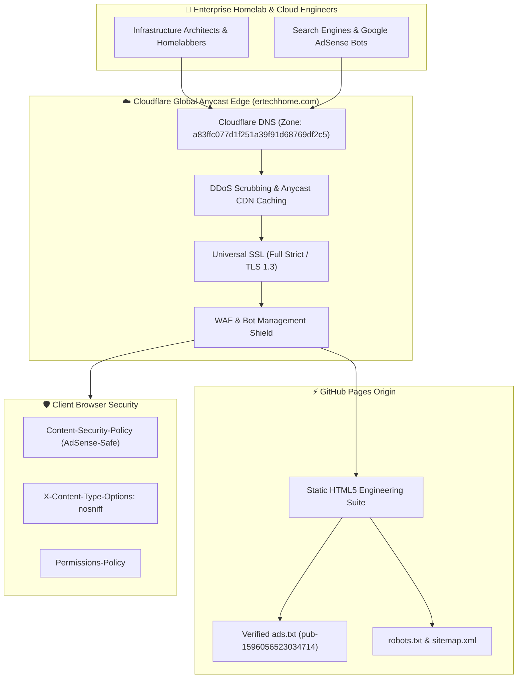

# 🖥️ ERTECH HOME // Enterprise Homelab Engineering, Cloud Architecture & Self-Hosted Tech

```text
 ███████╗██████╗ ████████╗███████╗ ██████╗██╗  ██╗    ██╗  ██╗ ██████╗ ███╗   ███╗███████╗
 ██╔════╝██╔══██╗╚══██╔══╝██╔════╝██╔════╝██║  ██║    ██║  ██║██╔═══██╗████╗ ████║██╔════╝
 █████╗  ██████╔╝   ██║   █████╗  ██║     ███████║    ███████║██║   ██║██╔████╔██║█████╗  
 ██╔══╝  ██╔══██╗   ██║   ██╔══╝  ██║     ██╔══██║    ██╔══██║██║   ██║██║╚██╔╝██║██╔══╝  
 ███████╗██║  ██║   ██║   ███████╗╚██████╗██║  ██║    ██║  ██║╚██████╔╝██║ ╚═╝ ██║███████╗
 ╚══════╝╚═╝  ╚═╝   ╚═╝   ╚══════╝ ╚═════╝╚═╝  ╚═╝    ╚═╝  ╚═╝ ╚═════╝ ╚═╝     ╚═╝╚══════╝
```

> **[OFFICIAL PRODUCTION REPOSITORY]**  
> *The definitive engineering portal for enterprise homelabs, Proxmox VE hypervisors, ZFS storage calculators, Kubernetes on bare metal, and self-hosted AI infrastructure.*  
> Engineered by **Efrain Rivas** — Senior Enterprise Infrastructure Architect.

---

## ⚡ Live Telemetry & Badges

[](https://ertechhome.com)
[](https://digdast.github.io/ertechhome-website/)
[](https://ertechhome.com)
[](https://dash.cloudflare.com)
[](https://ertechhome.com)
[](https://ertechhome.com/ads.txt)
[](https://tailwindcss.com)

---

## 🌟 Core Platform Highlights

1. **Enterprise ZFS Storage & RAID Pool Calculator**:
   - Interactive array modeling for **Mirror (RAID 10)**, **RAID-Z1 (RAID 5 equivalent)**, **RAID-Z2 (RAID 6 equivalent - recommended for drives > 8TB)**, and **RAID-Z3**.
   - Computes raw capacity, parity overhead, 80% ZFS copy-on-write performance safety threshold, and fault tolerance count.
2. **Cloud vs. On-Premises Homelab ROI Engine**:
   - Compares 3-year Total Cost of Ownership (TCO) between major hyperscalers (AWS EC2 / S3 / Egress, Azure, GCP) and enterprise on-premises refurbished hardware (Dell PowerEdge, HPE ProLiant, Supermicro).
   - Real-time payback timeline and breakeven calculations.
3. **Automated Docker Compose & Stack Blueprint Generator**:
   - Generates production-ready `docker-compose.yml` templates for:
     - **Sovereign AI Stack**: Ollama (GPU acceleration) + Open WebUI.
     - **Telemetry & Monitoring**: Prometheus + Grafana + Node Exporter.
     - **Enterprise Storage & Media**: Nextcloud Hub + Jellyfin + Portainer.
     - **Identity & Security Broker**: Authentik SSO + Nginx Proxy Manager.
4. **Google AdSense Revenue Engine**:
   - High CPC technology, enterprise cloud hosting, and server hardware keywords.
   - 100% verified authorized `ads.txt` integration (`pub-1596056523034714`).
5. **Hardened Production Security**:
   - Content Security Policy (CSP), subresource integrity, MIME sniffing protection, and origin masking.

---

## 🏗️ High-Availability Edge Architecture



---

## 🛡️ Security Hardening & Compliance

- **Content-Security-Policy (CSP)**: Restricts script execution to local origins, Google AdSense, and official CDNs while preventing unauthorized cross-origin requests.
- **MIME & Referrer Policies**: `X-Content-Type-Options: nosniff` and `Referrer-Policy: strict-origin-when-cross-origin`.
- **Permissions Policy**: `camera=(), microphone=(), geolocation=()` to protect visitor hardware.
- **Privacy & Compliance**: Integrated GDPR / CCPA cookie consent and privacy policy modals.

---

## 📂 Repository Topology

```text
ertechhome-website/
├── index.html        # High-performance homelab single-page app
├── ads.txt           # Google AdSense publisher validation (pub-1596056523034714)
├── robots.txt        # Universal search engine indexing directive
├── sitemap.xml       # Canonical XML sitemap for SEO discovery
├── CNAME             # GitHub Pages custom domain binding (ertechhome.com)
├── static/           # Vector branding assets, SVGs, and logos
└── README.md         # Architecture, security & telemetry documentation
```

---

## ⚖️ License & Attribution

Designed and maintained by **Efrain Rivas**.  
All rights reserved © 2026 **ERTechHome.com**.
